# 数学壁纸

十个硬核数学问题，做成可以长期挂在桌面图标后面的动态壁纸。暗底、磷光细线、慢镜头。每件都是一个独立的全屏页面，时间轴确定，同一个时刻永远是同一帧，所以可以录成无缝循环。

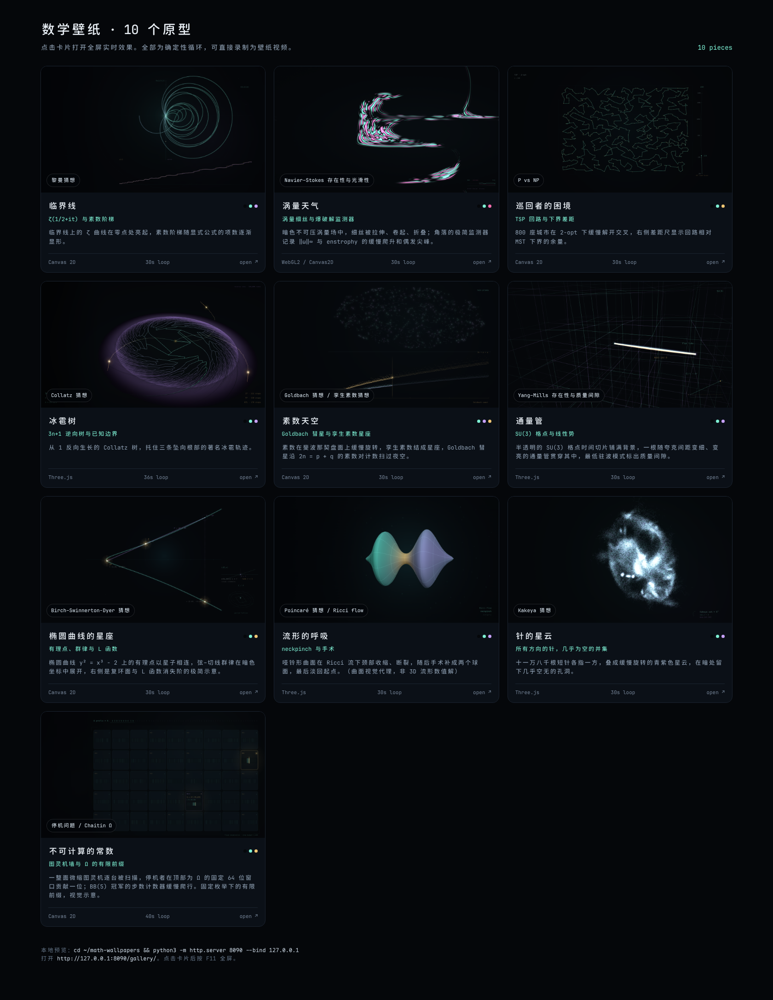

这些是可视化，不是证明，也不是论文图。画面把问题的结构摊开，让它能在桌面上待一整天。

## 十件作品

### 1 · 临界线 · 黎曼猜想

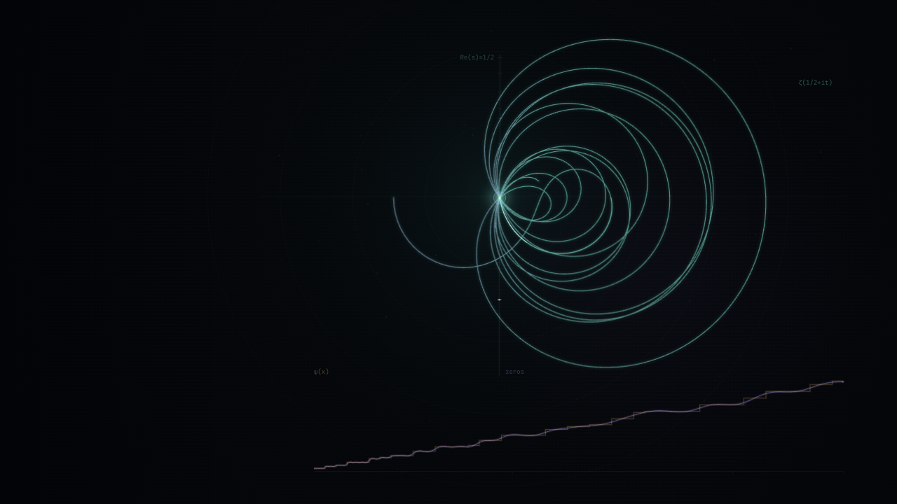

ζ(1/2 + it) 在复平面上绕着原点转。曲线经过原点时是一个零点。底下的紫线是素数阶梯 ψ(x)，显式公式的部分和逐渐把它从噪声里收出来。

[打开实时页面](pieces/riemann/index.html) · 30 秒 · Canvas 2D

### 2 · 涡量天气 · Navier–Stokes

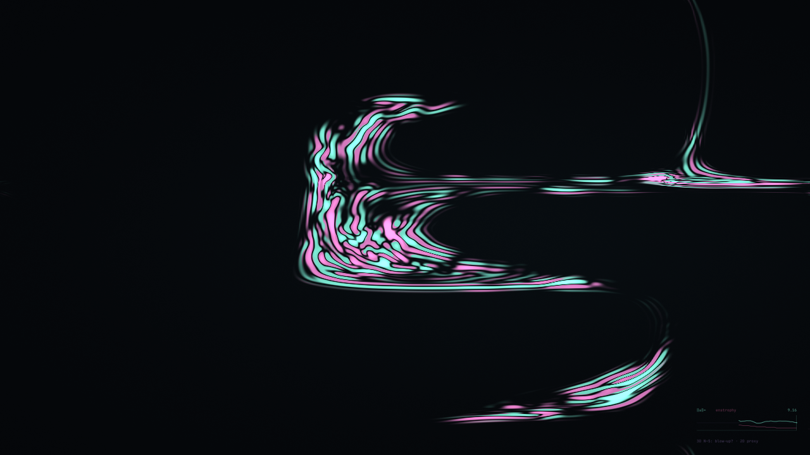

二维不可压涡量场。青色和品红是相反方向的涡量，细丝被卷起、拉长、折叠。右下角的细线记录 ‖ω‖∞ 和 enstrophy。三维光滑解会不会在有限时间爆破，仍然是千禧问题；这里是二维代理。

[打开实时页面](pieces/navier-stokes/index.html) · 30 秒 · WebGL2

### 3 · 巡回者的困境 · P vs NP

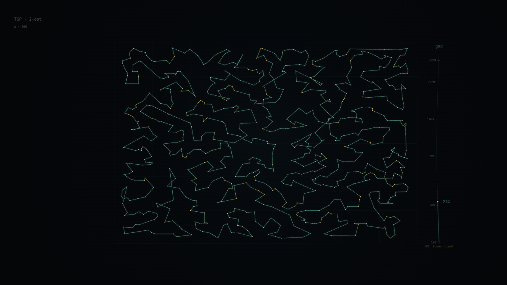

800 座城市。一条哈密顿回路在 2-opt 下把交叉解开，右侧差距尺是回路长度相对最小生成树下界的余量。启发式很能看，没有任何多项式保证。

[打开实时页面](pieces/p-vs-np/index.html) · 30 秒 · Canvas 2D

### 4 · 冰雹树 · Collatz

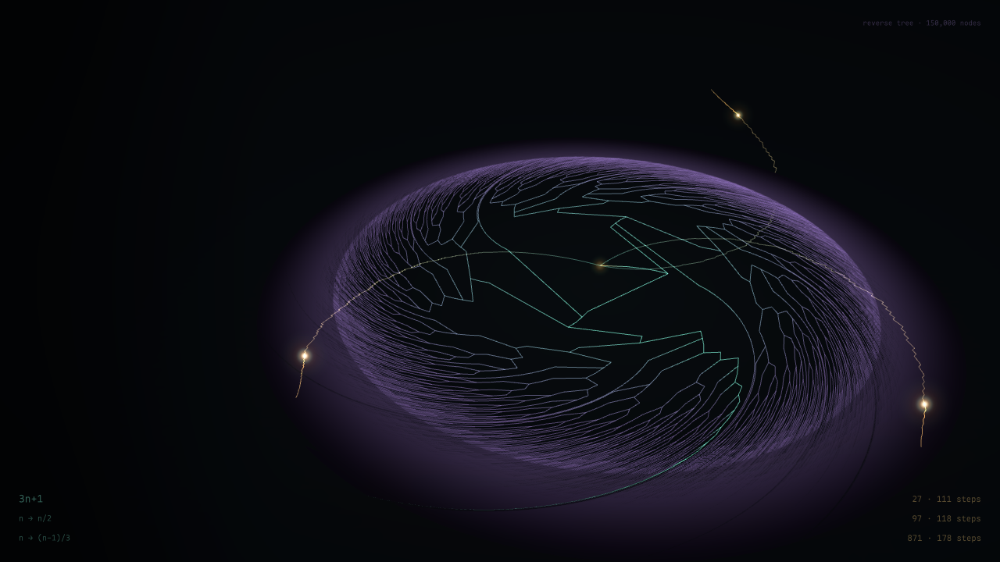

从 1 反向长出的 3n+1 树，大约 15 万个节点。27、97、871 三条轨迹像流星坠向根。树外面的整数区域保持黑暗。

[打开实时页面](pieces/collatz/index.html) · 36 秒 · Three.js

### 5 · 素数天空 · Goldbach / 孪生素数

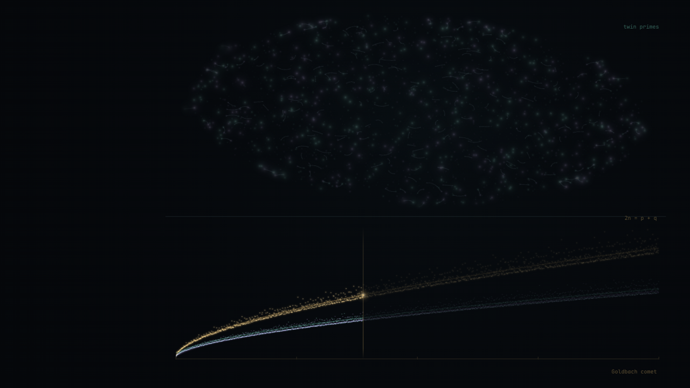

上半是素数星场，孪生素数用细线结成星座。下半是 Goldbach 彗星：偶数写成两个素数之和的方法数，按模 3 分成三条尾。

[打开实时页面](pieces/primes/index.html) · 30 秒 · Canvas 2D

### 6 · 通量管 · Yang–Mills

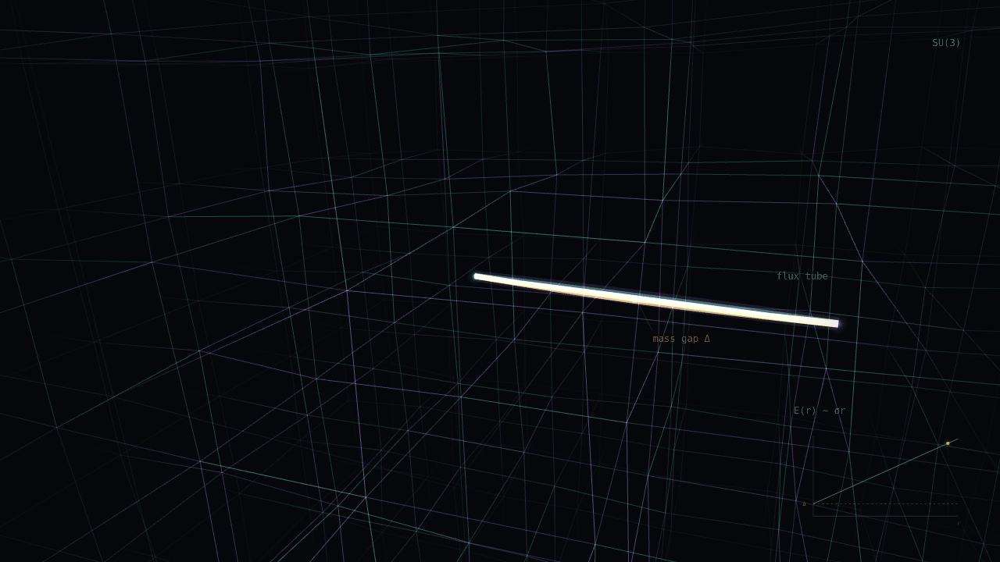

半透明的 SU(3) 格点时间切片铺在背景里。中间一根通量管连接夸克和反夸克，距离拉大时管子变细、能量线性上升。琥珀细线是管里的最低驻波，标着质量间隙。

[打开实时页面](pieces/yang-mills/index.html) · 30 秒 · Three.js

### 7 · 椭圆曲线的星座 · Birch–Swinnerton-Dyer

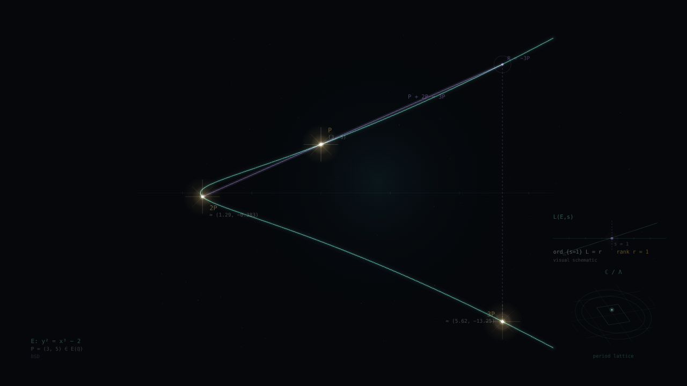

曲线是 y² = x³ − 2。有理点 P、2P、3P 是星子，弦–切线做出群律。右下是周期格和 L 函数在 s = 1 处消失阶的示意，标注为 visual schematic，没有伪造数值表。

[打开实时页面](pieces/bsd/index.html) · 30 秒 · Canvas 2D

### 8 · 流形的呼吸 · Poincaré / Ricci flow

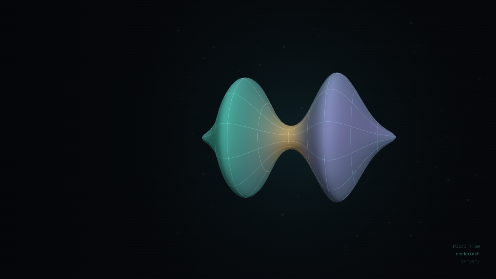

哑铃曲面是三维流形的视觉代理。颈部正曲率发暖，两瓣发冷。Ricci 流把脖子收紧，直到 neckpinch，然后手术切开、补成两个球面，再淡回起点。

[打开实时页面](pieces/ricci-flow/index.html) · 30 秒 · Three.js

### 9 · 针的星云 · Kakeya

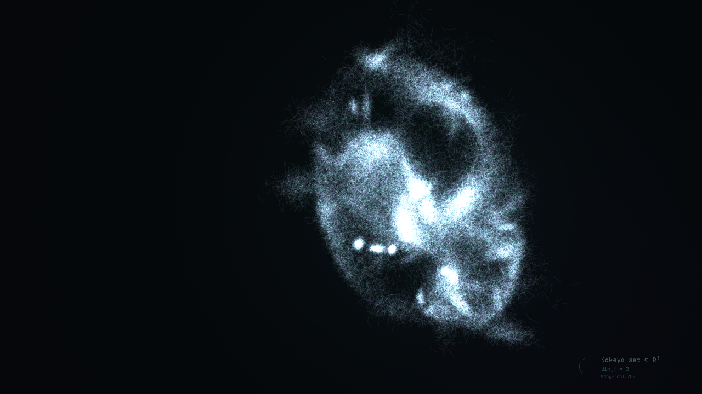

十一万多根短针，方向铺满球面，叠成一团几乎中空的星云。Wang–Zahl（2025）证明了三维 Kakeya 集的 Hausdorff 维数是 3。更高维仍然开放。

[打开实时页面](pieces/kakeya/index.html) · 30 秒 · Three.js

### 10 · 不可计算的常数 · 停机问题 / Chaitin Ω

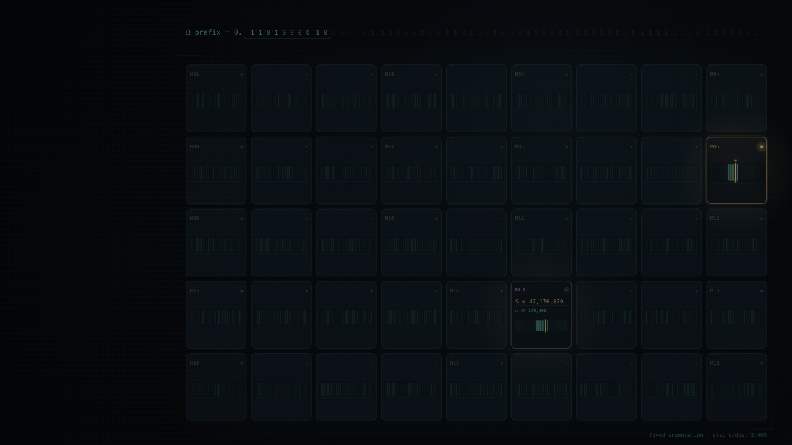

一面墙的微型图灵机。扫描光停在一台机器上时，纸带亮一下；在步数预算内停机的机器，向顶部那一行二进制贡献一位。那是固定枚举下 Ω 的有限前缀，不是 Ω 本身。角落里 BB(5) 冠军的步数计数器一直在走，S = 47,176,870。

[打开实时页面](pieces/omega/index.html) · 40 秒 · Canvas 2D

## 在浏览器里看

```bash
cd math-wallpapers
python3 -m http.server 8090 --bind 127.0.0.1
```

打开 <http://127.0.0.1:8090/gallery/>。点卡片进入全屏页面，再按 F11。

页面地址可以带时间：`?t=12` 停在第 12 秒，`?capture=1` 停在第 0 秒并暴露 `window.__wp`。实时播放不带参数。

## 做成桌面壁纸

GNOME 没有原生视频壁纸。这台机器用 [Gnome Live Wallpaper](https://github.com/achu94/gnome-wallpaper-engine)（mpv，GNOME 45–51）。需要本机已有 `mpv`、`ffmpeg` 和 `gh`。

```bash
bash tools/install-gnome-live-wallpaper.sh   # 安装扩展，并改成主屏取景、副屏裁切覆盖
bash tools/render-loops.sh 2560 1440 30      # 按每件自己的时长录成 H.264
bash tools/use-wallpaper.sh riemann          # 换成别的 slug 即可切换
```

Wayland 下新装的扩展要注销一次再登录才会加载。视频在 `~/.local/share/gnome-wallpaper-engine/backgrounds/`。`render-loops.sh` 优先用 NVENC，失败再退回 libx264。循环视频不进 git，仓库里是可再生成的页面。

主屏按 16:9 录。副屏是另一比例时，扩展把同一画面按 cover 裁切过去，不拉伸。

## 开发

```
shared/wallpaper.js     全屏画布、确定性时间轴、截图/录制 API
shared/vendor/          Three.js r180（页面直接引用，不经过打包器）
pieces/<slug>/          index.html、piece.js、meta.json、preview.png
tools/snapshot.js       单帧截图
tools/record.js         用 canvas.captureStream 录 WebM
tools/build_gallery.py  从 meta.json 生成画廊
```

截图和录制依赖系统 Chrome 与 `playwright-core`：

```bash
npm install
node tools/snapshot.js riemann pieces/riemann/preview.png 4 1280 720
node tools/record.js riemann 30 renders/riemann.webm 2560 1440 30
```

`renderAt(t)` 必须是纯函数。随机数用固定种子。预计算数据在 `pieces/*/data.json`，生成脚本是同目录的 `gen_data.py`（黎曼用 mpmath，素数用筛法，TSP 用 2-opt）。

设计约束写在 [BRIEF.md](BRIEF.md)：暗底、左侧留给图标、循环首尾相接、平均亮度压低。

## 许可

[MIT](LICENSE)。Three.js 为 MIT，见 `shared/vendor/`。Gnome Live Wallpaper 是独立项目，安装脚本只下载它的发行包，不把它的代码并进本仓库。
